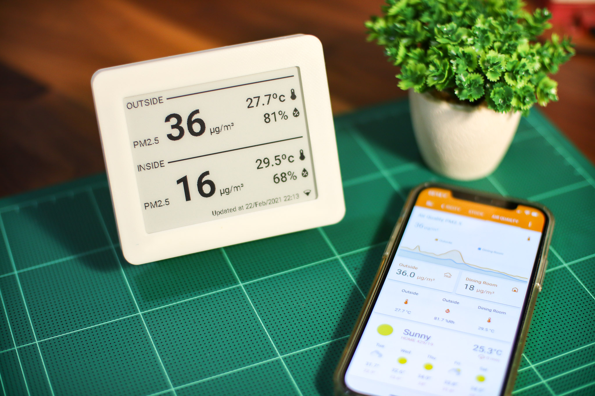
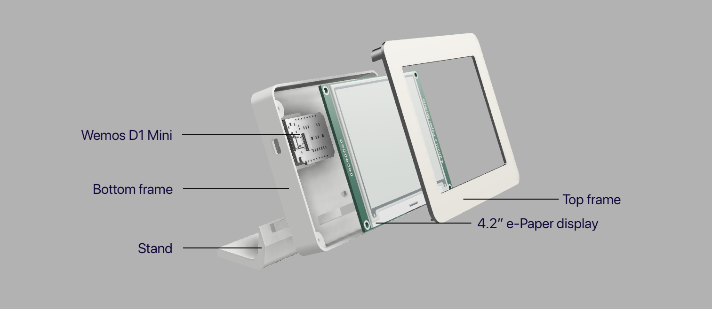

# HA Sensor ePaper Display
E-Paper display for viewing sensor data from Home Assistant. This firmware is based on **ESPhome**, so you need to install ESPhome and compile .yaml file by yourself.

## Sensors data 
The display shows PM2.5 value, temperature and humidity. Each set for indoor and outdoor.

I made PM2.5 the most prominent value. Because air pollution is currently a serious problem here in my hometime. Moreover, if the value exceeds the safety threshold, a warning sign will be displayed. 

## Hardware

### Parts:
 1. Waveshare 4.2" ePaper display
 2. Seeed Studio XIAO ESP32C3
 3. 3D-Printed Case, it can be found on my thingiverse page. [https://www.thingiverse.com/thing:4772803]
 4. Stock M3 Screws from ePaper display

Note: You might need to apply some adhesives to 3d-printed parts joints, and also put some counterweight on the base to make it harder to tip over. This is my very first time designing 3D things, so it’s not perfect yet.
 
 ### Wiring: 
Connecting the display to Seeed Studio XIAO ESP32C3 board is very straightforward. However, I soldered all wires diretly on both display and MCU in order to make it low-profile as much as possible.

|ePaper Display Pin| Seeed Studio XIAO ESP32C3 (GPIO number, not the board pin number)|
|--|--|
| BUSY | GPIO2 |
| RST | GPIO21  |
| DC | GPIO4 |
| CS | GPIO3 |
| CLK | GPIO8 |
| DIN | GPIO10 |
| GND | GND |
| VCC | 5V |

For an optional RGB LED strip, connect the data line to `GPIO 20`.

## How to use?

 1. Install ESPhome on your [computer](https://esphome.io/guides/getting_started_command_line.html) or [Home Assistant Add-on](https://esphome.io/guides/getting_started_hassio.html)
 2. Copy yaml file and fonts folder to your ESPhome folder.
 3. Edit your Wi-Fi SSID/Password, sensors entity ID, etc. as your own preference.
 4. Connect hardwares together.
 5. Flash the firmware. I recommended you to not flash via OTA.
 6. Go to Home Assistant, it should automatically discovered your espHome display. If not, add it manually using IP address via ESPhome integration.
 7. Enjoy!

# Changes from the original design.
- Switched from Wemos D1 Mini (ESP8266) to Seeed Studio XIAO ESP32C3 (ESP32-C3) due to insufficience memory issue of the ESP8266.
- Add the RGB LED lighting to indicate the outdoor air quality. This helps households to glance and understand air quality easily with color of the light.